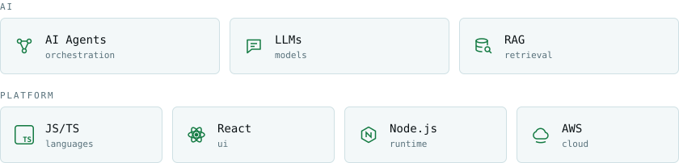
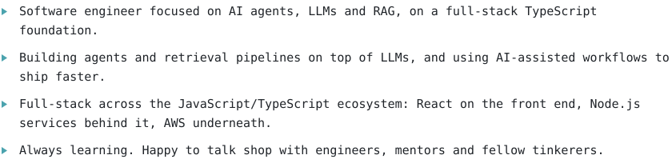
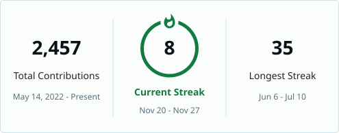

<!-- Images are built daily by .github/workflows/profile-assets.yml and published to the output branch -->

<picture>
  <source media="(prefers-color-scheme: dark)" srcset="https://raw.githubusercontent.com/dominik-deak/dominik-deak/output/dark/header.svg">
  
</picture>

  <a href="https://www.linkedin.com/in/dominik-deak/"><picture>
    <source media="(prefers-color-scheme: dark)" srcset="https://raw.githubusercontent.com/dominik-deak/dominik-deak/output/dark/link-linkedin.svg">
    </picture></a>
  <a href="https://dominik-deak.netlify.app"><picture>
    <source media="(prefers-color-scheme: dark)" srcset="https://raw.githubusercontent.com/dominik-deak/dominik-deak/output/dark/link-portfolio.svg">
    </picture></a>
  <a href="https://www.codewars.com/users/dominik-deak/"><picture>
    <source media="(prefers-color-scheme: dark)" srcset="https://raw.githubusercontent.com/dominik-deak/dominik-deak/output/dark/link-codewars.svg">
    </picture></a>

<picture>
  <source media="(prefers-color-scheme: dark)" srcset="https://raw.githubusercontent.com/dominik-deak/dominik-deak/output/dark/section-01.svg">
  
</picture>

<picture>
  <source media="(prefers-color-scheme: dark)" srcset="https://raw.githubusercontent.com/dominik-deak/dominik-deak/output/dark/stack.svg">
  
</picture>

<picture>
  <source media="(prefers-color-scheme: dark)" srcset="https://raw.githubusercontent.com/dominik-deak/dominik-deak/output/dark/section-02.svg">
  
</picture>

<picture>
  <source media="(prefers-color-scheme: dark)" srcset="https://raw.githubusercontent.com/dominik-deak/dominik-deak/output/dark/about.svg">
  
</picture>

<picture>
  <source media="(prefers-color-scheme: dark)" srcset="https://raw.githubusercontent.com/dominik-deak/dominik-deak/output/dark/section-03.svg">
  
</picture>

  <picture>
    <source media="(prefers-color-scheme: dark)" srcset="https://raw.githubusercontent.com/dominik-deak/dominik-deak/output/dark/stats.svg">
    
  </picture>
  <picture>
    <source media="(prefers-color-scheme: dark)" srcset="https://raw.githubusercontent.com/dominik-deak/dominik-deak/output/dark/streak.svg">
    
  </picture>

<picture>
  <source media="(prefers-color-scheme: dark)" srcset="https://raw.githubusercontent.com/dominik-deak/dominik-deak/output/dark/section-04.svg">
  
</picture>

<picture>
  <source media="(prefers-color-scheme: dark)" srcset="https://raw.githubusercontent.com/dominik-deak/dominik-deak/output/dark/snake.svg">
  
</picture>

<picture>
  <source media="(prefers-color-scheme: dark)" srcset="https://raw.githubusercontent.com/dominik-deak/dominik-deak/output/dark/footer.svg">
  
</picture>
